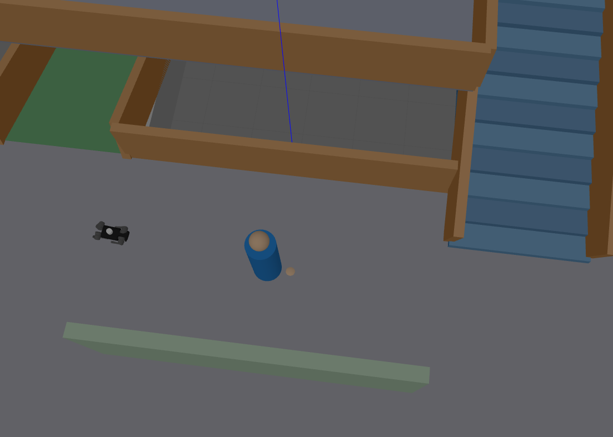
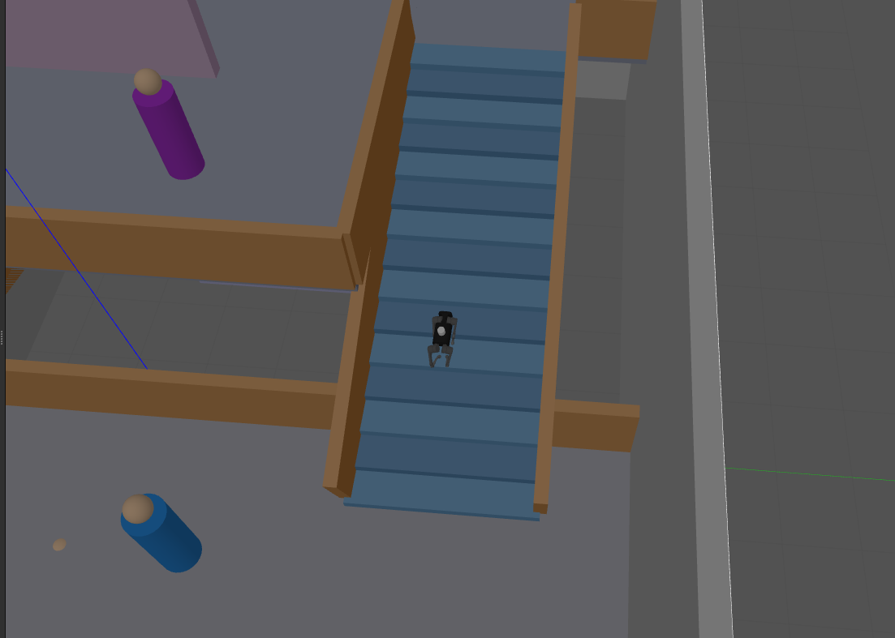

# Unitree A1 Autonomous Multi-Floor Perceptive Navigation

[](https://docs.ros.org/en/humble/)
[](https://gazebosim.org/)
[](https://navigation.ros.org/)
[](https://developer.nvidia.com/isaac-gym)

Autonomous 3-story navigation stack for the **Unitree A1** quadruped in **ROS 2 Humble + Gazebo Classic**, combining **Ouster OS1-32 3D LiDAR**, **DLIO (Direct LiDAR-Inertial Odometry)**, a **live 2.5D Rolling Elevation Map**, a **Perceptive PPO RL Locomotion Policy**, **Nav2**, and a **Topological Multi-Floor Graph Planner** to traverse flat corridors, a **14° enclosed ramp**, and a **15-step staircase** while avoiding dynamic human actors.

---

## Visual Showcase

| Floor 1 — Nav2 Costmap & 2.5D Elevation Grid | Climbing 14° Ramp (Floor 1 → Floor 2) |
| :---: | :---: |
|  |  |

| Floor 2 — Dynamic Actor & Connectors | Climbing 15-Step Staircase (Floor 2 → Floor 3) |
| :---: | :---: |
|  |  |

### Real-Time 2.5D Staircase Elevation Mapping (RViz)


---

## How It Works

### 1. Perceptive PPO Training (Isaac Gym → Gazebo)
- **Base Framework:** Built on ETH Zurich / NVIDIA **`legged_gym`** (`rsl_rl` PPO) with an asymmetric-terrain curriculum (`30%` smooth/rough slopes, `70%` up/down stairs).
- **Sim-to-Sim Physics Matching (`a1_config.py`):** Joint PD gains (`kp = 40.0`, `kd = 0.8`) are matched 1:1 to Gazebo (`URDF damping = 0.5 + pos_kd = 0.3 = 0.8`), with `self_collisions = 0` enabled and domain randomization over friction (`[0.5, 1.5]`), base mass (`[-0.5, +1.5] kg` covering the Ouster OS1-32 payload), and random velocity pushes.
- **Stair-Climbing Reward Shaping:** In addition to velocity tracking, the policy is trained with explicit stair-clearance terms: `stumble = -1.5` (penalizes foot impacts on vertical risers), `collision = -2.5` (penalizes thigh/calf scraping), `base_height = -1.0` (`0.32 m` target), `orientation = -0.5`, and A1-calibrated `feet_air_time = 1.5` (`0.25 s` swing target).
- **Deployment:** The trained actor MLP (`235 → 512 → 256 → 128 → 12`, ELU) is exported to `config/a1_policy_rough.npz` for dependency-free NumPy inference in ROS 2.

### 2. Live 2.5D Rolling Elevation Map (`elevation_map_node.py`)
- **Blind-Cone Problem:** Mounted at `z ≈ 0.41 m` with a `-22.5°` minimum vertical FOV, the Ouster OS1-32 cannot see a `~1.0 m` radius directly beneath the robot—yet the RL policy's `17 × 11` (`187`-dim) `height_scan` grid (`x ∈ [-0.8, +0.8] m`, `y ∈ [-0.5, +0.5] m`) lies inside this blind cone.
- **Odometry-Fused Rolling Grid:** `/ouster/points` (10 Hz) is transformed into the `odom` frame using `/dlio/odom_node/odom` pose/yaw and gravity-aligned `/imu/data` roll/pitch, then fused via EMA (`α = 0.45`) into an integer-shifted (`np.roll`) `5.0 m × 5.0 m` (`0.05 m` resolution) 2.5D grid. Vertical walls/actors (`cell_dz > 0.24 m`) are rejected so stairs/ramps scanned `1–2 m` ahead remain memorized directly beneath the robot's feet, publishing `height_scan` at **50 Hz**.

### 3. Deterministic 50 Hz RL Locomotion (`rl_locomotion_controller.py`)
- Driven directly by `/joint_states` `header.stamp` (`20 ms` sim-time steps) to eliminate ROS timer jitter.
- Assembles the `235`-dim observation vector (`base_lin_vel`, `base_ang_vel`, `projected_gravity`, `cmd_vel`, `dof_pos`, `dof_vel`, `last_action`, `height_scan`) and outputs joint position targets to `ros2_control` (`500 Hz` `joint_group_position_controller`), smoothly blending into a slope-adapted Hill-Hold stance when stationary.

### 4. Topological Multi-Floor Navigation (`floor_manager_node.py`)
- **Graph Routing & Goal Validation:** Floors (`z = 0.0, 1.50, 3.00 m`) and connectors (`ramp_1_2`: 14° ramp, `ramp_2_3`: 15-step `10×40 cm` staircase) are modeled in `building_topology.yaml`. `floor_goal_gui.py` and `floor_manager_node.py` validate goals against walls/connectors and compute the shortest floor sequence via **Dijkstra**.
- **Hybrid Nav2 + Connector Execution:**
  - **On flat floors:** **Nav2** navigates using the active floor's 2D occupancy map and 3D `ObstacleLayer` (`max_obstacle_height: 6.0`), avoiding dynamic patrolling human actors.
  - **On ramps & stairs:** At the connector handoff point, `floor_manager_node.py` aligns yaw and centerline, switches `map_server` to the target floor, and executes `_traverse_ramp_sync` (straight IMU yaw lock + gentle `linear.y` lateral centering) before handing control back to Nav2.

---

## Repository Structure

```text
a1_navigation_ws/
├── docs/images/                          # RViz & Gazebo screenshots
└── src/
    ├── a1_description/
    │   ├── config/
    │   │   ├── a1_controllers.yaml       # 500 Hz ros2_control PID gains
    │   │   ├── a1_policy_rough.npz       # Perceptive PPO policy (235-dim)
    │   │   ├── building_topology.yaml    # 3-floor graph & connector geometry
    │   │   └── nav2_params.yaml          # Nav2 Humble parameters
    │   ├── launch/
    │   │   ├── gazebo.launch.py          # Gazebo + A1 + DLIO + Elevation Map + RL
    │   │   └── navigation.launch.py      # Full Nav2 + Floor Manager + GUI
    │   ├── maps/                         # Floor 1, 2, 3 occupancy maps (.pgm/.yaml)
    │   ├── rviz/                         # RViz2 configurations
    │   ├── scripts/
    │   │   ├── elevation_map_node.py     # 2.5D rolling elevation map
    │   │   ├── rl_locomotion_controller.py # 50 Hz perceptive RL inference
    │   │   ├── floor_manager_node.py     # Multi-floor Dijkstra & transitions
    │   │   └── floor_goal_gui.py         # Interactive target-floor goal GUI
    │   ├── urdf/a1_with_lidar.xacro      # Unitree A1 + Ouster OS1-32 + IMU
    │   └── worlds/multi_floor_building.world # 3-story world (14° ramp + 15-step stairs)
    └── direct_lidar_inertial_odometry/   # DLIO 3D LiDAR-Inertial Odometry
```

---

## Quick Start

### 1. Build
```bash
source /opt/ros/humble/setup.bash
cd ~/a1_navigation_ws
colcon build --symlink-install
source install/setup.bash
```

### 2. Launch Full Multi-Floor Navigation
```bash
ros2 launch a1_description navigation.launch.py
```

This launches:
1. **Gazebo Classic** with the 3-story building (`multi_floor_building.world`) and dynamic actors
2. **DLIO** (`/dlio/odom_node/odom`) & **2.5D Elevation Map** (`/elevation_map/height_scan`, `/elevation_map/cloud`)
3. **50 Hz Perceptive RL Controller** (`rl_locomotion_controller.py`)
4. **Nav2 + Multi-Floor Manager** (`floor_manager_node.py`)
5. **RViz2** & **Multi-Floor Goal GUI** (`floor_goal_gui.py`)
