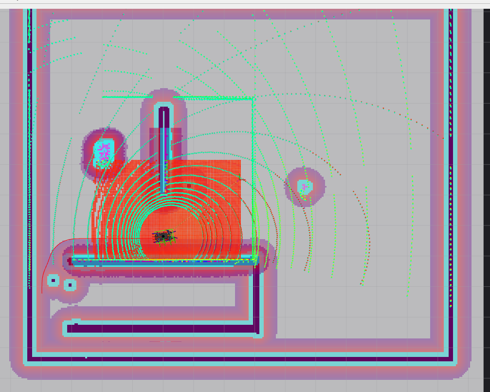
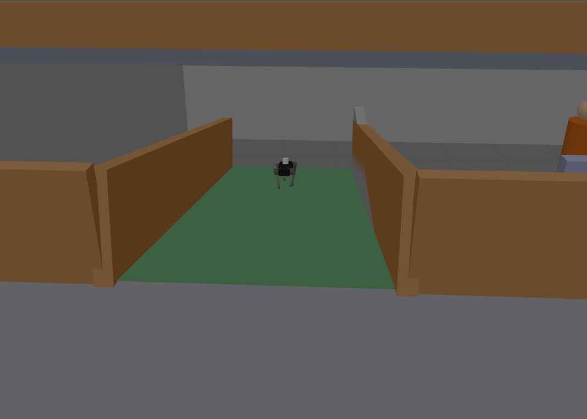
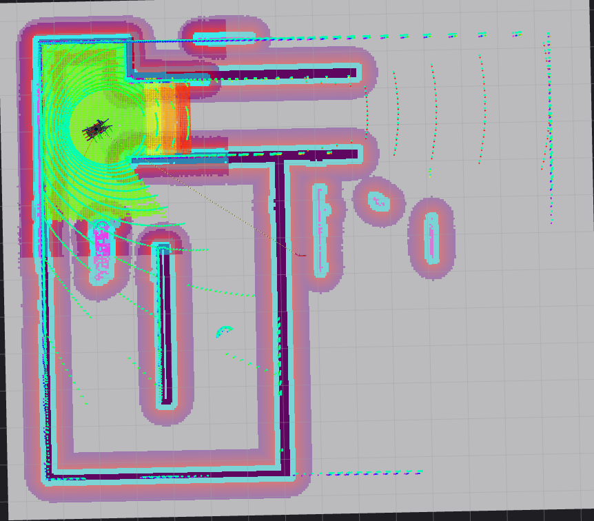

# Unitree A1 Autonomous Multi-Floor Perceptive Navigation

[](https://docs.ros.org/en/humble/)
[](https://gazebosim.org/)
[](https://navigation.ros.org/)
[](https://developer.nvidia.com/isaac-gym)

Autonomous 3-story navigation stack for the **Unitree A1** quadruped in **ROS 2 Humble + Gazebo Classic**, combining **Ouster OS1-32 3D LiDAR**, **DLIO (Direct LiDAR-Inertial Odometry)**, a **live 2.5D Rolling Elevation Map**, a **Perceptive PPO RL Locomotion Policy**, **Nav2**, and a **Topological Multi-Floor Graph Planner** to traverse flat corridors, a **14° enclosed ramp**, and a **15-step staircase** while avoiding dynamic human actors.

---

## Visual Showcase

| Floor 1 — Nav2 Costmap & 2.5D Elevation Grid | Climbing 14° Ramp (Floor 1 → Floor 2) |
| :---: | :---: |
|  |  |

| Floor 2 — Dynamic Actor & Connectors | Climbing 15-Step Staircase (Floor 2 → Floor 3) |
| :---: | :---: |
|  |  |

### Real-Time 2.5D Staircase Elevation Mapping (RViz)


---

## Key Features

- **3-Story Topological Navigation (`floor_manager_node.py`, `building_topology.yaml`):**
  - Plans optimal multi-floor routes via **Dijkstra** across 3 floors (`z = 0.0 m`, `1.50 m`, `3.00 m`).
  - Automatically switches Nav2 `map_server` floor maps, aligns yaw/centerline before connectors, and hands off between Nav2 and deterministic corridor tracking on ramps/stairs.
- **Live 2.5D Rolling Elevation Mapping (`elevation_map_node.py`):**
  - Fuses `/ouster/points` (10 Hz) with DLIO odometry and gravity-aligned IMU roll/pitch into a `5.0 m × 5.0 m` (`0.05 m` resolution) rolling height grid in `odom` frame.
  - Bridges the Ouster `-22.5°` blind cone beneath the robot so stairs and ramps scanned `1–2 m` ahead remain memorized directly under the feet, publishing a `17 × 11` (`187`-dim) `height_scan` at **50 Hz**.
- **Gazebo-Matched Perceptive PPO RL (`rl_locomotion_controller.py`, `a1_policy_rough.npz`):**
  - Trained in NVIDIA Isaac Gym (`kp = 40.0`, `kd = 0.8` matched to Gazebo `damping=0.5 + pos_kd=0.3`), with stair-climbing rewards (`stumble`, `collision`, `base_height`, `orientation`, `feet_air_time`) and `235`-dim perceptive observations (`48` proprioceptive + `187` `height_scan`).
  - Deterministically stepped at **50 Hz sim time** driven by `/joint_states` timestamps (zero ROS timer jitter).
- **Dynamic Social-Yielding Actors & Interactive Goal GUI (`floor_goal_gui.py`):**
  - Dynamic human actors patrol each floor while Nav2 `ObstacleLayer` (`max_obstacle_height: 6.0`) marks obstacles across all 3 floors.
  - Tkinter GUI (`floor_goal_gui.py`) previews each floor's 2D map, highlights forbidden ramp/stair zones, shows live robot position, and validates clicked goals against walls/connectors.

---

## Repository Structure

```text
a1_navigation_ws/
├── docs/images/                          # RViz & Gazebo screenshots
└── src/
    ├── a1_description/
    │   ├── config/
    │   │   ├── a1_controllers.yaml       # 500 Hz ros2_control PID gains
    │   │   ├── a1_policy_rough.npz       # Perceptive PPO policy (235-dim)
    │   │   ├── building_topology.yaml    # 3-floor graph & connector geometry
    │   │   └── nav2_params.yaml          # Nav2 Humble parameters
    │   ├── launch/
    │   │   ├── gazebo.launch.py          # Gazebo + A1 + DLIO + Elevation Map + RL
    │   │   └── navigation.launch.py      # Full Nav2 + Floor Manager + GUI
    │   ├── maps/                         # Floor 1, 2, 3 occupancy maps (.pgm/.yaml)
    │   ├── rviz/                         # RViz2 configurations
    │   ├── scripts/
    │   │   ├── elevation_map_node.py     # 2.5D rolling elevation map
    │   │   ├── rl_locomotion_controller.py # 50 Hz perceptive RL inference
    │   │   ├── floor_manager_node.py     # Multi-floor Dijkstra & transitions
    │   │   └── floor_goal_gui.py         # Interactive target-floor goal GUI
    │   ├── urdf/a1_with_lidar.xacro      # Unitree A1 + Ouster OS1-32 + IMU
    │   └── worlds/multi_floor_building.world # 3-story world (14° ramp + 15-step stairs)
    └── direct_lidar_inertial_odometry/   # DLIO 3D LiDAR-Inertial Odometry
```

---

## Quick Start

### 1. Build
```bash
source /opt/ros/humble/setup.bash
cd ~/a1_navigation_ws
colcon build --symlink-install
source install/setup.bash
```

### 2. Launch Full Multi-Floor Navigation
```bash
ros2 launch a1_description navigation.launch.py
```

This launches:
1. **Gazebo Classic** with the 3-story building (`multi_floor_building.world`) and dynamic actors
2. **DLIO** (`/dlio/odom_node/odom`) & **2.5D Elevation Map** (`/elevation_map/height_scan`, `/elevation_map/cloud`)
3. **50 Hz Perceptive RL Controller** (`rl_locomotion_controller.py`)
4. **Nav2 + Multi-Floor Manager** (`floor_manager_node.py`)
5. **RViz2** & **Multi-Floor Goal GUI** (`floor_goal_gui.py`)
